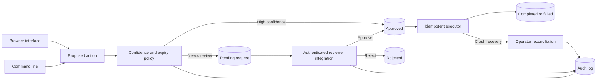

# Human Approval Agent

## About

Some actions should wait for a person before they happen. This app keeps those actions in a review queue: it records exactly what was proposed, lets an authorized reviewer approve or reject it, and executes only the approved version. Every decision and state change is saved so an operator can see what happened later.

### What you can do

- Propose a local file write and receive a request ID for review.
- List pending requests, approve or reject them, and inspect their history.
- Resume an approved request without silently changing its payload.
- Reconcile a request after a crash without repeating an uncertain external action.

The CLI and local operator browser use a durable SQLite store. The Python library can gate other actions, such as sending a message or changing a record, when integrated with a trusted executor. The caller must authenticate reviewers; this library records who approved an action but does not verify their identity on its own. There is no public hosted URL yet.

## Quick start

Requires Python 3.11 or newer. From this repository:

```powershell
python -m venv .venv
.\.venv\Scripts\Activate.ps1
python -m pip install -e '.[dev]'
pytest -q
```

On macOS or Linux:

```bash
python3 -m venv .venv
source .venv/bin/activate
python -m pip install -e '.[dev]'
pytest -q
```

This project uses deterministic tests and needs no model key for verification.

The installed `approval-agent` product runs an actual review queue for local file writes. Run `approval-agent --db approvals.sqlite3 --outdir approved-output propose report.txt "Approved content"`, copy the returned request ID, then run `approval-agent --db approvals.sqlite3 approve ID --actor reviewer-1` and `approval-agent --db approvals.sqlite3 --outdir approved-output execute ID`. `list` and `history ID` inspect the durable state. For the browser, run `approval-agent --db approvals.sqlite3 --outdir approved-output serve --port 8080` and open `http://127.0.0.1:8080`. Keep the browser bound to localhost; the host operator controls who can review.

```python
from human_approval_agent.engine import ApprovalStore

store = ApprovalStore("approval.sqlite3")
request = store.propose("send_email", {"to": "a@example.com"}, confidence=0.4)
print(request.id, request.status)
# A separate authorized reviewer process decides:
store.decide(request.id, actor="reviewer-1", approve=True)
store.resume(request.id, executor=lambda action, payload: print(action, payload))
print(store.history(request.id))
```

## Architecture



| Component | Responsibility |
|---|---|
| Request store | Persists immutable payload, digest, expiry, and idempotency key. |
| Review transition | Records actor decisions in a transaction. |
| Execution checkpoint | Resumes approved work once and supports audited reconciliation. |

Proposal -> SQLite pending checkpoint -> authenticated reviewer integration -> atomic status transition -> executor -> completed or failed audit event.

See [ARCHITECTURE.md](ARCHITECTURE.md) for components, state, failure behavior, and operations.

## Deployment and safety

See [DEPLOYMENT.md](DEPLOYMENT.md) for the non-root container, token-protected browser, data mounts, and release checks.

The library records actor names but does not authenticate them; the integrating API must authenticate reviewers. External side effects need idempotency keys because a process crash during execution cannot be rolled back automatically.

Install this as a library in an authenticated application or worker. Register trusted handlers and keep application secrets outside source control.

## Verification

`pytest -q` runs deterministic tests. GitHub Actions runs the same suite on pushes and pull requests.

## License

MIT. See [LICENSE](LICENSE).
