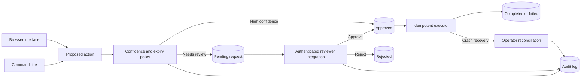

# Human Approval Agent

## About

Some actions should wait for a person before they happen. This app keeps those actions in a review queue: it records exactly what was proposed, lets an authorized reviewer approve or reject it, and executes only the approved version. Every decision and state change is saved so an operator can see what happened later.

### What you can do

- Propose a local file write and receive a request ID for review.
- List pending requests, approve or reject them, and inspect their history.
- Resume an approved request without silently changing its payload.
- Reconcile a request after a crash without repeating an uncertain external action.

The CLI and local operator browser use a durable SQLite store. The Python library can gate other actions, such as sending a message or changing a record, when integrated with a trusted executor. The caller must authenticate reviewers; this library records who approved an action but does not verify their identity on its own. There is no public hosted URL yet.

## Quick start

Requires Python 3.11 or newer. From this repository:

```powershell
python -m venv .venv
.\.venv\Scripts\Activate.ps1
python -m pip install -e '.[dev]'
pytest -q
```

On macOS or Linux:

```bash
python3 -m venv .venv
source .venv/bin/activate
python -m pip install -e '.[dev]'
pytest -q
```

This project uses deterministic tests and needs no model key for verification.

The installed `approval-agent` product runs an actual review queue for local file writes. Run `approval-agent --db approvals.sqlite3 --outdir approved-output propose report.txt "Approved content"`, copy the returned request ID, then run `approval-agent --db approvals.sqlite3 approve ID --actor reviewer-1` and `approval-agent --db approvals.sqlite3 --outdir approved-output execute ID`. `list` and `history ID` inspect the durable state. For the browser, run `approval-agent --db approvals.sqlite3 --outdir approved-output serve --port 8080` and open `http://127.0.0.1:8080`. Keep the browser bound to localhost; the host operator controls who can review.

```python
from human_approval_agent.engine import ApprovalStore

store = ApprovalStore("approval.sqlite3")
request = store.propose("send_email", {"to": "a@example.com"}, confidence=0.4)
print(request.id, request.status)
# A separate authorized reviewer process decides:
store.decide(request.id, actor="reviewer-1", approve=True)
store.resume(request.id, executor=lambda action, payload: print(action, payload))
print(store.history(request.id))
```

## Architecture



| Component | Responsibility |
|---|---|
| Request store | Persists immutable payload, digest, expiry, and idempotency key. |
| Review transition | Records actor decisions in a transaction. |
| Execution checkpoint | Resumes approved work once and supports audited reconciliation. |

Proposal -> SQLite pending checkpoint -> authenticated reviewer integration -> atomic status transition -> executor -> completed or failed audit event.

See [ARCHITECTURE.md](ARCHITECTURE.md) for components, state, failure behavior, and operations.

## Deployment and safety

See [DEPLOYMENT.md](DEPLOYMENT.md) for the non-root container, token-protected browser, data mounts, and release checks.

The library records actor names but does not authenticate them; the integrating API must authenticate reviewers. External side effects need idempotency keys because a process crash during execution cannot be rolled back automatically.

Install this as a library in an authenticated application or worker. Register trusted handlers and keep application secrets outside source control.

## Verification

`pytest -q` runs deterministic tests. GitHub Actions runs the same suite on pushes and pull requests.

## Product guide

### From proposal to outcome

1. A caller proposes an action and the exact payload to execute. It receives a request ID; an optional idempotency key makes retries return the same proposal.
2. The request enters the pending queue if it needs review. The reviewer inspects the payload and records an approval or rejection with an actor name.
3. Only an approved request can resume. The stored payload cannot be swapped after the decision.
4. The executor records completion or failure. `history` shows the sequence of events for the request.

| CLI action | Use it when |
|---|---|
| `propose` | A file write needs a checkpoint before it happens. |
| `list` | A reviewer wants to see pending work. |
| `approve` / `reject` | A reviewer has made a decision. |
| `execute` | Approved work should be applied once. |
| `history` | An operator needs the audit trail for one request. |

The bundled CLI executor writes files under the output directory selected by the operator. The library can guard a different operation through a trusted executor callback. File paths are validated against that output directory, and request records live in SQLite so a restart does not erase the queue.

### Trust and crash recovery

This product records the reviewer name but does not prove who that person is. Put authentication and authorization in the API or workflow that calls `decide`. The local browser is intended for a controlled operator environment. Requests can expire after `ttl_seconds`; retrying proposal creation can use an idempotency key.

An external side effect can finish just before a process crashes, leaving its final status uncertain. The system deliberately does not run it again automatically. An operator should inspect the downstream system, then use `reconcile` to mark the observed outcome. That decision is added to the audit trail. Handlers that call external systems should also pass idempotency keys downstream.

### Deployment checklist

Persist and back up the SQLite database and the output directory together. Restrict who can approve and who can execute. Run `pytest -q` and a full propose → approve → execute → history check after changing the executor. The Docker option and local browser token are described in [DEPLOYMENT.md](DEPLOYMENT.md). [ARCHITECTURE.md](ARCHITECTURE.md) explains the state transitions in more detail.

### Common issues

| Symptom | Check |
|---|---|
| `execute` refuses a request | Inspect its status and history; it must be approved and unexpired. |
| A retry creates an unexpected request | Reuse the same idempotency key for the same proposal. |
| A file is not written | Confirm the output path is relative to the configured directory and the request was executed. |
| A crash left an uncertain outcome | Inspect the downstream effect and use audited reconciliation; do not blindly execute again. |

For a real team workflow, connect reviewer identity to the `actor` value through a trusted authentication service. Never allow the proposal creator to self-approve unless your policy explicitly permits it.

## License

MIT. See [LICENSE](LICENSE).
