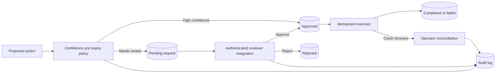

# Human Approval Agent

Pause uncertain actions, record human decisions, and resume only an approved immutable payload with an audit trail.

Set `ttl_seconds` for expiring requests and an `idempotency_key` for callers that may retry proposal creation. Reviewer authentication remains the responsibility of the API that calls `decide`.

After a process crash during an external side effect, an operator can inspect the downstream system and call `reconcile(request_id, actor=..., outcome="completed" | "failed")`. Reconciliation is audited and never repeats the side effect.

## Quick start

Requires Python 3.11 or newer. From this repository:

```powershell
python -m venv .venv
.\.venv\Scripts\Activate.ps1
python -m pip install -e '.[dev]'
pytest -q
```

On macOS or Linux:

```bash
python3 -m venv .venv
source .venv/bin/activate
python -m pip install -e '.[dev]'
pytest -q
```

This project uses deterministic tests and needs no model key for verification.

```python
from human_approval_agent.engine import ApprovalStore

store = ApprovalStore("approval.sqlite3")
request = store.propose("send_email", {"to": "a@example.com"}, confidence=0.4)
print(request.id, request.status)
# A separate authorized reviewer process decides:
store.decide(request.id, actor="reviewer-1", approve=True)
store.resume(request.id, executor=lambda action, payload: print(action, payload))
print(store.history(request.id))
```

## Architecture



| Component | Responsibility |
|---|---|
| Request store | Persists immutable payload, digest, expiry, and idempotency key. |
| Review transition | Records actor decisions in a transaction. |
| Execution checkpoint | Resumes approved work once and supports audited reconciliation. |

Proposal -> SQLite pending checkpoint -> authenticated reviewer integration -> atomic status transition -> executor -> completed or failed audit event.

See [ARCHITECTURE.md](ARCHITECTURE.md) for components, state, failure behavior, and operations.

## Deployment and safety

The library records actor names but does not authenticate them; the integrating API must authenticate reviewers. External side effects need idempotency keys because a process crash during execution cannot be rolled back automatically.

Install this as a library in an authenticated application or worker. Register trusted handlers and keep application secrets outside source control.

## Verification

`pytest -q` runs deterministic tests. GitHub Actions runs the same suite on pushes and pull requests.

## License

MIT. See [LICENSE](LICENSE).
